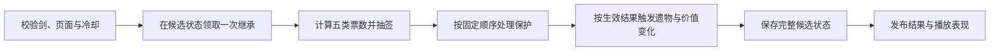

# 锤击与闭环的执行契约

本工程以工具站自报的Steam build 25755699为概率参考，叠加官方10月7日起手赠礼池修正。它是独立实现与公开浏览器模型的对照，不是原生Steam二进制等价声明。[研究证据](Research/rule-evidence.md)区分了这些来源。

## 一锤的顺序

抽签顺序固定为碎裂、损伤、不变、成功、大成功。基础权重为`[9,2,5,12,2]`；镰锤会替换部分基础权重。其他修饰来自当前遗物、等级阈值、剑的累计计数、局累计计数和下一锤道具。目录中的94个启用遗物共用一条结果链，不为广告或界面另写概率分支。

令修饰后的碎裂权重为`b`，其他四项之和为`s`，当前等级曲线为`c`：

1. 碎裂权重先变为`b × c/(1−c) × 21/9`。
2. 求该权重占总和的概率，再乘淬火伤痕、护符层数、星/线准备状态、封印和等级达标后的铁钳等减伤因子。
3. 将调整后的碎裂概率换回权重，保留其余四项的相对关系。
4. 入神或满充能预览将碎裂权重置零；锻造粉在普通锤中将成功/大成功折为大成功，将其他三项折为碎裂。
5. 归一到1000票：各项向下取整，余票按小数余数从大到小分配；相同余数按固定结果顺序分配。

精确修饰及先后顺序由`RiskForgeRules.Tickets`唯一负责，界面百分比直接读取它。预览对剑和局状态的副本进行继承预处理，不消耗继承、随机数、库存或次数。星屑的真实使用则在同一候选事务中先领取继承，再增加3点充能，避免吞掉已有继承充能。

## 抽签与真碎裂分开

抽到碎裂仍需经过保护链：龙鳞优先，然后是适用的遗物保护。一次抽签只消费首先适用的保护；保护将结果改为损伤时，下游损伤遗物看到的是改后的结果。某些保命效果保留原结果类型，不能一律按损伤处理。

龙鳞不改票数；它只为下一锤提供保护，而且下一锤无论什么结果都会消耗。广告只增加库存中的龙鳞，由玩家手动武装。原始抽签概率和已武装提示分别显示。

真碎裂先保存待确认事件、碎前/碎后剑、碎后上下文和已经前进的结果RNG。确认损失只接纳一次碎后经济/继承/计数分支，重复关闭或重启不能再次领取碎料与金币。本版不提供碎后广告复活，也不把这个边界当作原版撤销。

## 价值、时间与随机数

价值沿用基础值、等级的`1.5^grade`、加法层、乘法层及条件倍率，封顶`1e100`；等级封顶99。固定金币增加先折算到加法层，里程碑使用位标记，降级后重新跨越不能再次领取同一奖励。临时拥有加成与剑上保留的累计成长分开处理。

普通锤积累充能，上限10；下一锤满充能时开始入神。基础入神4秒，可被原遗物延长；基础锤击间隔0.64秒，由原速度修饰决定。只有前台锻造页面推进时钟，切页、弹层、后台及广告都暂停；恢复首帧不补算后台经过的时间。

结果、商店和外观使用不同RNG状态。预览、模型重建、广告加载与奖励不抽结果RNG。表现浮字和轻微震动由已提交结果驱动，不能通过动画回调再次结算。

## 订单与经济

保留21单原配额、有限供剑、剑信用、原遗物报价、商人价格与逐次三倍涨价、19项原成就及其开池条件。交付价值换金币，卖剑信用不同时给金币；替换遗物不额外产出旧遗物退款。

第21单完成看结算后是否存活，不能要求21单全部足额。延期需求按原研究表的直接幂次公式计算，不使用逐日向下取整递推。皇室零钱的次日抵扣在完成等待页暂存为`NextRoyalCredit`，选择延期时才进入下一日，避免用次日抵扣反校验当天配额。

商人把剑直接送入手游剑柜，适配原版的物理空手接剑操作；不会要求整个库存为空。空柜补剑后立即建立有效选择。移除回溯报价会影响原商人池及售罄成本，这一差异保留在[来源记录](economy-provenance.json)，不宣称完全还原。

## 本次广告边界

- 同一本地档案初始2槽，逐次永久开启第3–8槽，最多6次成功奖励。容量满时仍可购买并显式替换。
- 龙鳞广告每契约最多成功领取一次，只在合法商人到访页请求。与永久槽位独立计数。
- 两种请求都绑定档案、契约、订单及唯一请求；槽位还绑定前容量和下一目标格。仅允许一个请求在途。
- SDK真实获奖证据、奖励、额度和去重记录在同一次保存中提交。关闭、无广告、加载失败和取消不领奖。
- 写入失败不发布候选状态；在当前进程内保留同一获奖回执重试，无需重看。若进程在磁盘持续不可写时被终止，客户端不能保证恢复尚未写入的SDK证据；本版未采用服务器验证。

## 已验证范围

概率有133个固定向量；后置效果包含949条外部回放、7994个中间状态、15条动态上下架及13条事件快照。原生Unity序列化、Session命令、保存失败和广告状态机分别验证，报告见`Research`与`Ads`。

两种合法操作策略覆盖2/4/8槽及龙鳞有无，共240个正式模拟流程。它们用于查命令错误、资源守恒和闭环，不能解释为240名独立玩家或真实胜率。未知原生细节及缺失的完整回溯仍见[缺口表](Research/rule-gaps.json)。
